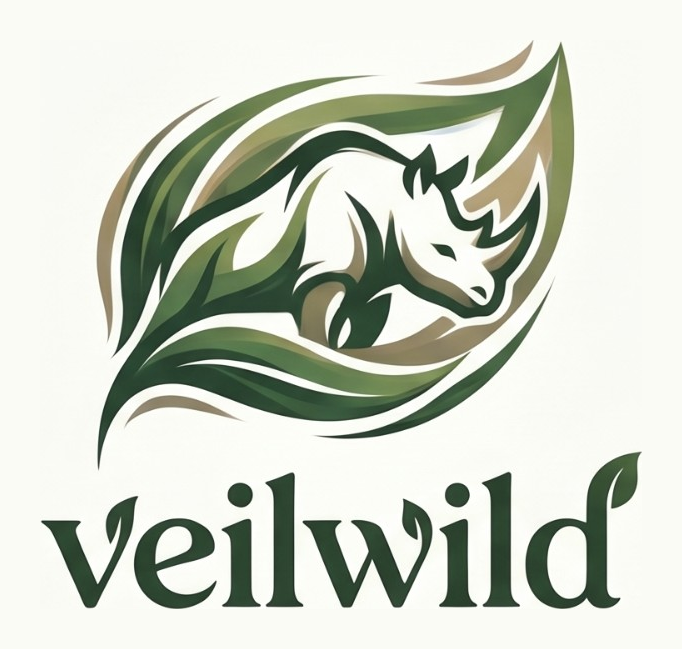
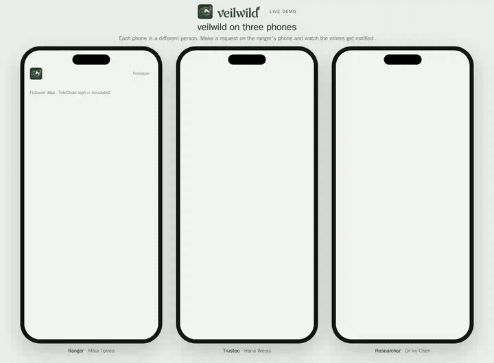

<p align="center">
  <picture>
    <source media="(prefers-color-scheme: dark)" srcset="logo-dark.png">
    
  </picture>
</p>

<p align="center"><b>A ranger sees an endangered animal's location only when two independent people approve.</b><br>
RMIT Hackathon 2026 · Tide UNLOCKED</p>

> **Status:** Working Plan C prototype. TideCloak identity and independent authorisation are simulated; live integration was attempted but not completed.

<p align="center">
  <a href="demo.mp4"></a><br>
  <sub>Click for the full-quality video (<code>demo.mp4</code>, 34 s).</sub>
</p>

## Project overview

**Veilwild** is a wildlife intelligence-sharing prototype where a ranger can unlock a specific endangered animal's location only after a researcher and an independent trustee approve.

### Vision & originality
Rather than replacing conservation databases, Veilwild proposes an access layer for sharing sensitive wildlife locations with field rangers. Requests are limited to a named animal and a specific conservation purpose, not unrestricted access to all tracking records.

### Trust constraint insight
Location data collected to protect endangered species could also expose them to poaching if improperly released. Ordinary administrator-controlled permissions leave one privileged operator able to override the intended rules. Veilwild's intended model separates the ability to operate the system from the authority to disclose sensitive data.

### Value & impact
A ranger responding to potential poaching activity can request an individual rhino's location for a patrol. The researcher responsible for that animal's area and an independent trustee must both authorise the same request. Other animals' locations remain unavailable.

### Why TideCloak matters
TideCloak's identity, encryption and governance approach could prevent a single administrator from granting themselves access. Our **Plan C prototype simulates** identity verification, roles and independent approval requirements. Live TideCloak integration was attempted but could not be completed reliably; independent key custody and administrator-resistant enforcement are **not yet implemented**.

### Prototype & storytelling
Three interactive phones show the ranger requesting a location, the trustee and researcher receiving notifications, and each independently approving. One approval leaves the location locked; the second unlocks only the requested fictional animal. Browser WebCrypto provides AES-GCM encryption and HMAC checks, but the keys remain together in the demo runtime.

## Access flow

1. **Ranger:** Authenticates, selects one geographical section and gives a clear conservation reason for requesting access.
2. **Administrator:** Reviews the request details and routes it; cannot reveal protected locations or bypass approvals.
3. **Area researcher:** Approves or rejects access to the endangered-wildlife records in their assigned section.
4. **Independent trustee:** Separately approves or rejects the same request.
5. **Protected release:** Only the authorised ranger receives access to the approved section; all other sensitive locations remain inaccessible.

**Key demonstration:** Even an administrator cannot reveal an endangered animal's location alone. One approval is insufficient; two valid approvals permit access to only the requested section.

## Try the prototype

No build step and no dependencies. Serve the folder and open it in a browser:

```bash
python3 -m http.server 8765
```

- **http://localhost:8765/demo.html** — three phones side by side (Ranger, Trustee, Researcher) sharing one live session. On the ranger's phone, request an animal's location (for example Rhino 1) and give a reason. The trustee and researcher are notified, can see whether the other has approved, and approve or decline. Once both approve, the location appears on the ranger's phone.
- **http://localhost:8765/** — the same app on one screen, with a switcher for the three people.

WebCrypto needs a secure context, so use `localhost` (or HTTPS, such as GitHub Pages) rather than opening the file directly.

### What is real and what is simulated

| | Prototype |
|---|---|
| Location encryption | Real: AES-GCM via the browser's WebCrypto |
| Approvals | Real HMAC signatures, checked before a location is decrypted |
| Sign-in and roles | **Simulated** |
| Key custody | **Simulated:** every key lives in the browser tab, so this does not stop a real administrator |

The prototype shows the experience. Enforcement that holds even against a compromised administrator is what the TideCloak integration adds.

## Moving to TideCloak

This is a hackathon software prototype. Live TideCloak integration was attempted but could not be completed reliably. The working browser simulation demonstrates identity-specific requests, two separate approvals and narrowly scoped location disclosure.

A production version would move identity verification, approval authority and decryption key custody into independently enforced Tide-backed controls. **Do not treat this prototype as protection against a compromised administrator.**

## Repository layout

| Path | What it is |
|---|---|
| `index.html` | The prototype: one self-contained page |
| `demo.html` | Three-phone demo; each phone is `index.html?as=<person>` |
| `index-planc.html` | Fallback copy of the simulated prototype |
| `demo.mp4`, `demo.gif` | Recording of the demo flow |
| `emblem.png`, `wordmark-mask.png`, `logo-*.png`, `favicon-32.png`, `apple-touch-icon.png` | Logo, emblem, favicons and wordmark mask |
| `record-demo.mjs` | Re-records `demo.mp4` with Playwright |

## Data

All animals, people and locations in this repository are fictional. Use synthetic locations for development and never upload real-world locations of endangered animals.
